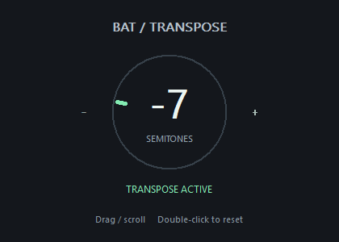

# BAT-transpose

A simple VST3 guitar pitch shifter with one knob, from −12 to +12 semitones.
Available for Windows, Linux, and macOS.



Other pitch shifters felt too complicated. I wanted a standalone plugin that works like the transpose feature in Neural DSP's Archetype plugins: set the pitch and play, without unnecessary options.

## Comparison

Offline comparison with Archetype Nolly X 1.0.2. Attack delay (median of 40 synthetic guitar attacks per setting):

| Transpose     |      BAT |  Nolly X |
| ------------- | -------: | -------: |
| −12 semitones |  5.57 ms | 22.42 ms |
| −7 semitones  |  6.46 ms | 14.86 ms |
| −2 semitones  |  6.56 ms |  5.58 ms |
| +2 semitones  |  8.19 ms |  6.88 ms |
| +7 semitones  |  9.15 ms |  7.07 ms |
| +12 semitones | 10.49 ms |  7.54 ms |

BAT produced more unwanted spectral artifacts than Nolly X on dense, low chords.

These measurements do not reflect subjective sound quality or total live latency.

Requires Git, CMake 3.25+, Ninja, and a C++17 compiler.

- Windows: Visual Studio Build Tools with C++ desktop tools
- macOS: Xcode
- Linux: Development packages listed in `.github/workflows/build.yml`

**Windows (PowerShell):**

```powershell
./scripts/bootstrap.ps1
./scripts/build.ps1
./scripts/package.ps1
```

**Linux / macOS:**

```sh
bash scripts/bootstrap.sh
bash scripts/build.sh
bash scripts/package.sh
```

Packages are saved in `dist/`.

Version tags like `v0.2.0` trigger builds for all three platforms on GitHub and create a draft release with ZIP files once all tests pass.

---

**Yusuf Molla** · [MIT License](LICENSE)
